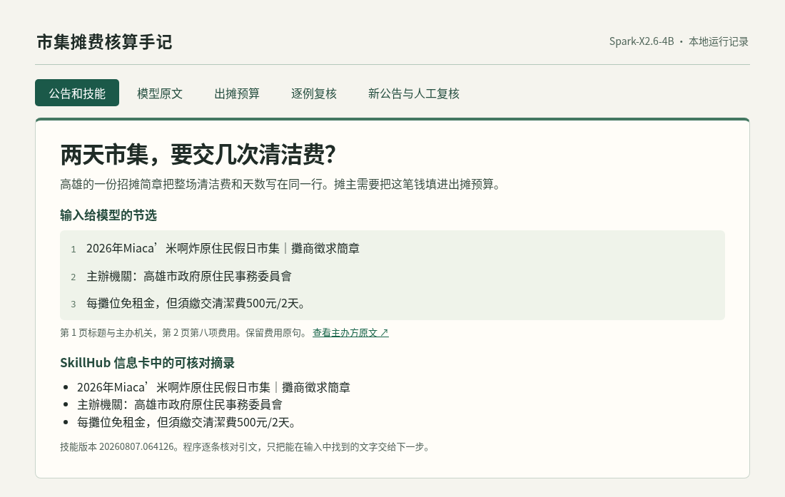
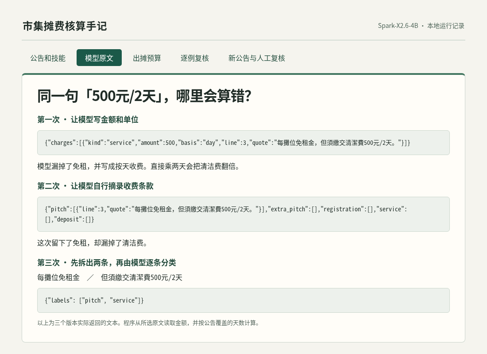
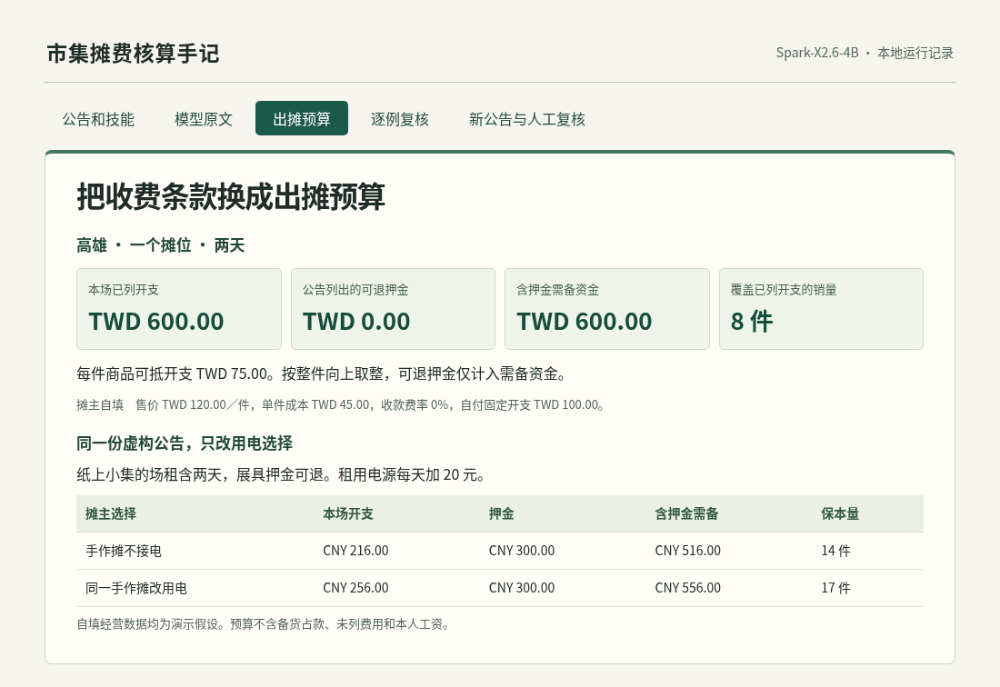
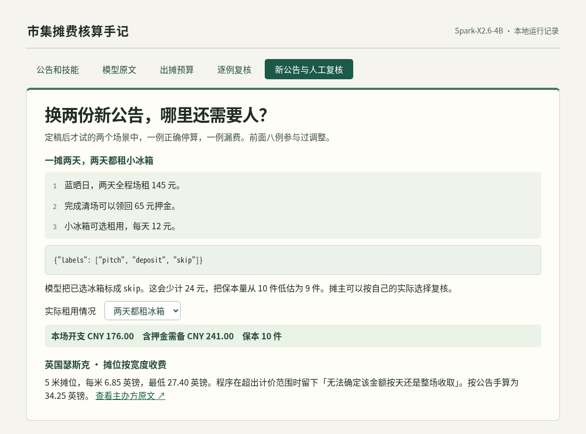

# 市集摊费核算手记

手作摊主拿到招摊公告，常常需要分别算清三笔账：要花多少、要垫多少、要卖几件才能覆盖开支。一句「清潔費500元/2天」就能让模型把同一笔费用算两遍。这个小实验保留了错误、改法以及新样例中仍会漏算的费用。

下载并在浏览器打开 [离线核算手记](report.html)，可以看每例的输入和模型原文，也可以在「新公告与人工复核」里切换是否租用冰箱。下面的截图来自实际运行结果。






## 一场市集的账

高雄主办方列明两天的租金为零，清洁费合计 500 新台币。假设摊主自行承担固定开支 100 元，每件售价 120 元、成本 45 元，收款费率为零，那么每件可抵 75 元，卖 8 件即可覆盖已列的 600 元。只有公告收费来自主办方，售价等经营数据是演示假设。[高雄招摊简章第八项](https://coia.kcg.gov.tw/admin/ct/news/20260401230530.pdf)

另一份虚构公告写明展具押金 300 元，正常归还后退回。两天都接电时，开支 256 元，含押金需预留 556 元，按例中售价和成本计算需卖 17 件。押金占用资金，履约退回后不计入本场开支。遇到只公布报名费的公告，程序会把场租和保本量留待确认。[澳门塔石艺墟公告](https://www.icm.gov.mo/gb/News/detail/24381)

## 技能和模型分别做了什么

Codex 从讯飞 SkillHub 搜到并安装了 `global/extract-government-document-info`，版本为 `20260807.064126`。第一步将安装文件中的原始技能说明和高雄公告节选提交给本机 Spark，得到带出处和缺失字段的信息卡。程序在输入中逐字核对卡片摘录，核实的三条随公告交给下一步。这里处理的是选出的费用段落。[技能详情](https://skill.xfyun.cn/space/global/extract-government-document-info) · [原始信息卡回复](evidence/source-card.json)

在最终版本中，Python 先按原文标出含价格、免收或待报价的条款。Spark 结合摊主选择，把每条判为场租、附加摊位、报名、服务、押金、跳过或需复核。Python 从对应原句读取金额和计费单位，用十进制定点数处理每日与整场收费，计算可退押金和保本件数。每次调用的用户输入、模型可见回复、停止原因和 token 计数均已保存。[运行代码与模型提示词](run.py) · [最终八例](evidence)

## 如何检查结果

最初六例的收费类别、单价、单位、行号和四项预算都在调用模型前写定。四项预算是已列开支、已列押金、含押金需备资金和保本件数。严格得分要求这些项目全部一致，缺失金额也必须正确保留。运行程序在保存模型回复之后才读取参考结果。[场景输入](cases.json) · [预期结果](expected.json)

| 方法 | 实际结果 |
| --- | --- |
| 模型直接填写金额和单位 | 1/6 全项相符。高雄清洁费被标作按天收取。[原始记录](first-pass) |
| 模型自由摘取各类收费引文 | 4/8 全项相符。增加了两个场景，高雄这次漏掉清洁费。[原始记录](quote-pass) |
| 先从原文拆出条款，模型逐条分类 | 8/8 全项相符。这八例都属于开发阶段，其中两例共用一段公告。[原始记录](evidence/results.json) |
| 分类和计价代码定稿后再试两例 | 一例按预期停算，另一例漏选冰箱。此轮保留首次输出。[新输入和预期](fresh-cases.json) · [实测结果与代码校验值](fresh/results.json) |

新例中的冰箱每天 12 元。模型忽略了摊主「两天都租」的选择，少列 24 元，把保本量从 10 件算成 9 件。打开离线手记，确认「两天都租冰箱」，即可在页面看到开支 176 元、含押金需备 241 元和保本 10 件。英国瑟斯克按摊位宽度收费且有最低价，程序留待复核，5 米摊位手算为 34.25 英镑。[瑟斯克费率](https://www.northyorks.gov.uk/business-and-economy/commercial-services-and-venues/apply-market-pitch/apply-pitch-thirsk-market)

每个场景分别以公告当地货币核算。公告可能还有节选以外的收费或资格条件。实际使用时，摊主需要核对所有自选项目和退款条件。这里没有摊主实地试用样本。

## 复现

回放已保存的模型响应只需要 Python 3.10 或以上。在仓库根目录执行以下命令，然后打开 `report.html`。

```sh
python run.py --replay
python fresh.py --replay
python report.py
```

要重新运行模型，请从官方模型库取得 `Spark-X2.6-4B-Q4_K_M.gguf`。本次使用官方 GGUF 修订 `9d716770ac7477776de5f891f70cdf98b003a5cd`，文件 3,543,441,312 字节，SHA-256 为 `91cb2811aebb47ac916aa619d27d4cdd7f4143106b7917accb8ead4cd7f5cbd9`。请在下载前核对磁盘容量和网络用量。[官方量化文件](https://huggingface.co/XHToken/Spark-X2.6-4B-GGUF/blob/9d716770ac7477776de5f891f70cdf98b003a5cd/Spark-X2.6-4B-Q4_K_M.gguf)

运行环境为 AMD Ryzen 7 8745HS、Linux x86-64、Python 3.14.10、llama.cpp build 12110（`cd959bae99`）。模型在 CPU 上使用 6 个线程、4,096 token 上下文和一个推理槽。采样温度为 0，种子为 42，思考预算为 0。信息卡上限为 750 个输出 token，分类上限为 520 个。[讯飞模型说明](https://huggingface.co/XHToken/Spark-X2.6-4B)

```sh
npm exec --yes --package @astron-team/skillhub@0.3.1 -- skillhub install global/extract-government-document-info --dir "$PWD/.local-skills" --registry https://skill.xfyun.cn
llama-server -m /path/to/Spark-X2.6-4B-Q4_K_M.gguf --alias spark-market --host 127.0.0.1 --port 18973 --device none -ngl 0 -t 6 -tb 6 -c 4096 -np 1 --jinja --reasoning-budget 0
```

保持模型服务运行，在第二个终端执行以下命令。程序会校验安装的 `SKILL.md`，本次内容的 SHA-256 为 `0ee728e36eb24f11a8a071ba6a82ff6ff29ac0e8ad9e35c02af1f3392a1e4241`。如技能市场更新，请使用详情页里的已记录版本，或通过 `--skill` 指定该版文件。在独立工作副本中运行可以保留仓库附带的原始记录。

```sh
python run.py
python fresh.py
python report.py
```

## 数据与贡献

调试集包含四个取自公开公告或价目的场景和四个原创情境。英国两个调试场景取自当地市政部门。两项新增检验使用一份原创公告和瑟斯克公开费率。所有商品售价、成本、租用决策都是演示条件。[曼彻斯特市政价目](https://www.manchester.gov.uk/markets/sell-to-customers/casual-trading2/occupancy-charges) · [莱斯特市政价目](https://www.leicester.gov.uk/business-and-licences/business-start-and-growth-leicester/trading-leicester-market)

本项目以个人身份参加 HER Hack-Astron 第 8 期文档提取方向。参赛者发起项目、授权本地运行和公开投稿并登录账号。Codex 完成场景设计、代码、资料核对、评测与图文制作。本地 Spark 实际生成信息卡和分类，标准库 Python 完成计算。数据和截图均来自这些公开或虚构的输入。[赛事说明](https://github.com/XHToken/Spark-X2.6/issues/32)
